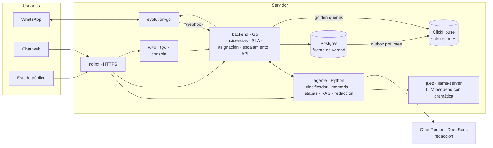
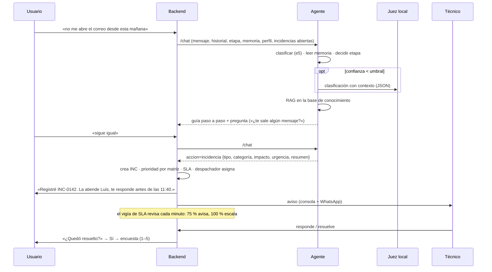
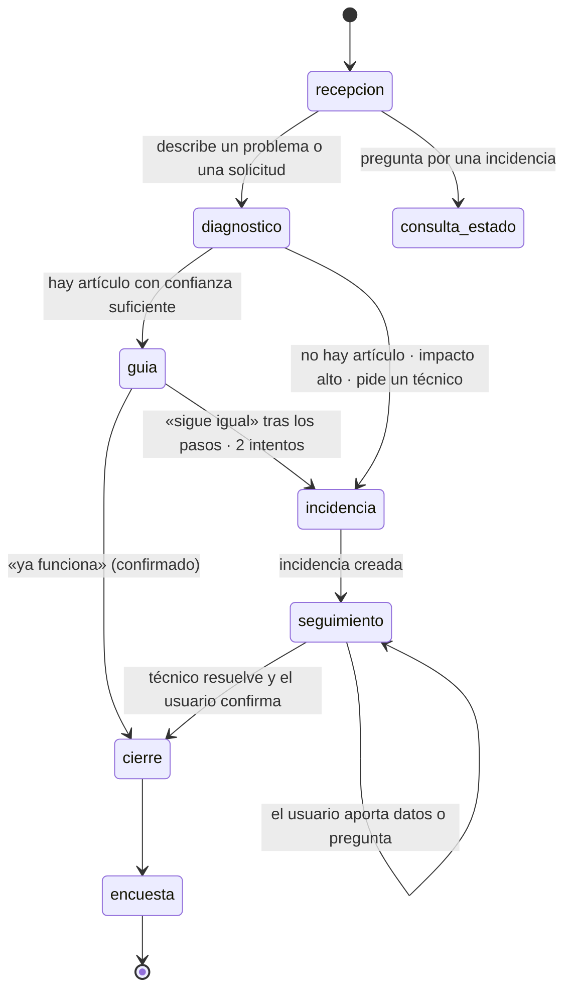
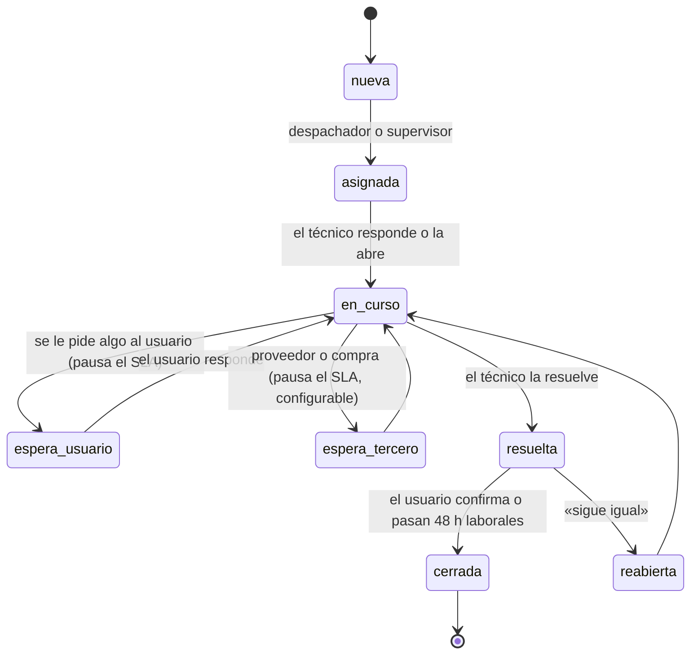
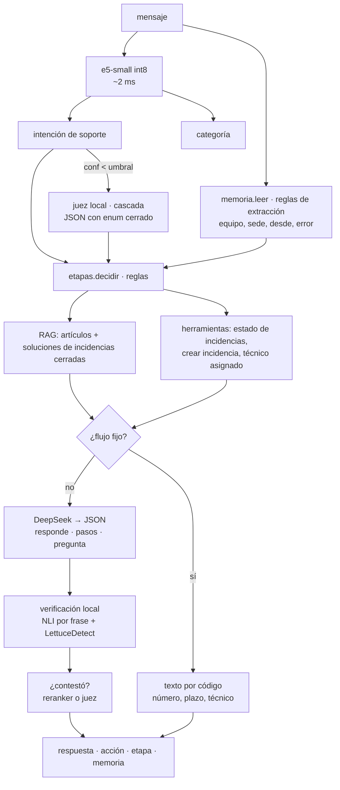

# jsrbot — Arquitectura

Arquitectura propuesta para jsrbot, la mesa de ayuda con asistente conversacional. Parte de la del asistente de
Baruka ([`referencias/baruka/ARQUITECTURA.md`](referencias/baruka/ARQUITECTURA.md)) y añade:

- el gestor de incidencias;
- el personal técnico y el escalamiento;
- un juez local open source («Jev local»);
- la reportería en ClickHouse con golden queries.

Estado: **diseño con implementación local** (05-10-2026); donde el código difiere, manda `docs/CONTRATOS.md`. Las cifras marcadas **[E]** son estimaciones que se miden en el plan;
las fuentes de los modelos están en [`docs/INVESTIGACION_JEV_LOCAL.md`](docs/INVESTIGACION_JEV_LOCAL.md).

---

## 1. Vista general



| Servicio | Tecnología | Responsabilidad |
|---|---|---|
| `jsrbot_evolution` (+ su Postgres) | evolution-go | Canal WhatsApp, igual que en Baruka |
| `jsrbot_motor` | Go | **Incidencias, SLA, asignación, escalamiento**; eventos; vigía; outbox hacia ClickHouse; golden queries (API interna `/interno/*`) |
| `jsrbot_pasarela` | OCaml (Dream) | API de la consola; autenticación y roles; webhook de WhatsApp; flujo del caso; envío de avisos; chat web; estado público |
| `jsrbot_agente` | Python 3.12, FastAPI, onnxruntime | Clasificador local, memoria, etapas, RAG sobre la base de conocimiento, redacción, **verificación de grounding**, resumen del caso |
| `jsrbot_juez` | `llama-server` (llama.cpp) | LLM pequeño para la cascada de clasificación y «¿contestó?», con salida por esquema JSON |
| `jsrbot_postgres` | Postgres 16 | Fuente de verdad: incidencias, eventos, técnicos, configuración, conocimiento, feedback |
| `jsrbot_clickhouse` | ClickHouse | Reportería, KPI, analista |
| `jsrbot_web` | Qwik + nginx | Consola, chat web de prueba, página pública de estado |

---

## 2. Recorrido de un caso



### 2.1 Etapas de atención

Las decide `agente/app/etapas.py` con reglas, como las etapas comerciales de Baruka:



**Reglas clave:**

- **P1 sin guía.** Una caída que afecta a una sede o a toda la organización va directo a incidencia, y el vigía la
  manda a la guardia.
- **Petición de una persona.** «Quiero hablar con un técnico» siempre se respeta.
- **Una sola incidencia abierta por síntoma.** Si la persona ya tiene una abierta del mismo síntoma, se añade a esa
  y no se crea otra.
- **Cierre confirmado.** Para cerrar hace falta confirmación. Sin respuesta en 48 h laborales, se cierra con el
  motivo «sin confirmación» y no cuenta para el FCR.

### 2.2 Ficha del caso (memoria corta)

Es la misma técnica de Baruka: pregunta pendiente, datos extraídos y siguiente pregunta elegida por el código.

```json
{
  "etapa": "diagnostico", "pendiente": "mensaje_error",
  "sabemos": {"sintoma": "correo no sincroniza", "aplicacion": "Outlook", "desde": "hoy 08:30",
              "equipo": "PC-CONT-07", "sede": "Centro", "area": "Contabilidad",
              "impacto": "persona", "urgencia": "media", "pasos_probados": ["reiniciar", "cerrar sesión"]},
  "articulos_mostrados": ["KB-031"], "intentos_guia": 1, "incidencia": null,
  "preguntado": ["que_pasa", "desde", "equipo"]
}
```

`memoria.siguiente()` elige qué falta según la categoría. Para correo: aplicación, mensaje de error, desde cuándo, si
afecta a otros. Para impresora: sede y piso, nombre de la impresora, si imprime alguien más. Lo que la persona ya
dijo no se vuelve a preguntar.

---

## 3. Gestor de incidencias

### 3.1 Ciclo de vida



**Prioridad**: la matriz impacto × urgencia es configurable. Valores por defecto (`SUPUESTO:` hasta conocer la
organización):

| Impacto \ Urgencia | crítica | alta | media | baja |
|---|---|---|---|---|
| organización | P1 | P1 | P2 | P3 |
| sede | P1 | P2 | P2 | P3 |
| área | P2 | P2 | P3 | P4 |
| persona | P2 | P3 | P3 | P4 |

**SLA**: plazos de primera respuesta y de resolución por prioridad, y opcionalmente por categoría.

- Se cuentan en **horario laboral** de un calendario: días, horas y feriados de Perú, configurables.
- P1 puede ser 24×7.
- Las pausas (`espera_usuario`, `espera_tercero`) detienen el reloj.
- El reloj se calcula desde los eventos, nunca guardando un contador.

### 3.2 Personal técnico

| Entidad | Contenido |
|---|---|
| `tecnicos` | Persona, contacto (WhatsApp, correo), nivel (N1/N2/N3), estado (activo, ausente), capacidad máxima de incidencias abiertas |
| `grupos` | Mesa N1, Redes, Aplicaciones, Infraestructura, Proveedor X… con su responsable |
| `habilidades` | Relación técnico ↔ categoría con nivel (1–3) |
| `turnos`, `ausencias` | Cuándo trabaja cada técnico; vacaciones y permisos |
| `guardias` | Quién responde a P1 fuera de horario, por semana |

**Despachador**: entre los técnicos del grupo de la categoría que están en turno, con capacidad libre y la
habilidad, elige el de menor carga ponderada (P1 = 4, P2 = 2, P3 y P4 = 1). Si empatan, el que lleva más tiempo sin
recibir una. Sin candidato, va a la cola del grupo y avisa al responsable.

### 3.3 Escalamiento

Las reglas son datos (`escalamiento_reglas`), versionadas, con modo `sombra` / `activo`:

| Disparador | Acción por defecto (`SUPUESTO:`) |
|---|---|
| 75 % del plazo de respuesta o resolución | Aviso al técnico |
| 100 % del plazo | Escalamiento funcional al siguiente nivel y aviso jerárquico al responsable del grupo |
| P1 creada | Aviso inmediato a la guardia y al responsable de TI |
| Reapertura por segunda vez | Escalamiento funcional y aviso al supervisor |
| Sentimiento muy negativo o queja explícita | Aviso al supervisor |
| Usuario VIP (lista configurable) | Prioridad mínima P2 y aviso al supervisor |
| El asistente no resolvió en 2 guías | Incidencia con nota «guía agotada» |

**Vigía de SLA:** es un *job* del backend que corre cada minuto. Recalcula los plazos de las incidencias abiertas,
aplica las reglas y deja un evento por acción. Usa el mismo programador por minuto que Baruka: no se baja a
intervalos mayores, porque un aviso del 75 % llegaría tarde.

---

## 4. El agente por dentro

El pipeline es el de Baruka (§5 de su arquitectura). Estas son las diferencias:



- **Intenciones de soporte**, conjunto inicial: `reportar_falla`, `solicitar_acceso`, `solicitar_equipo`,
  `restablecer_clave`, `consultar_estado`, `aportar_dato`, `confirmar_solucion`, `sigue_igual`, `pedir_tecnico`,
  `queja`, `agradecer`, `saludo`, `fuera_de_alcance`.
- **Categorías**, conjunto inicial (`SUPUESTO:`): correo, cuentas y accesos, red y wifi, VPN, impresoras, equipo,
  software de oficina, sistema interno, telefonía, otro.
- **Lo que nunca escribe el LLM:** números de incidencia, plazos, nombres de técnicos y estados. Son flujos fijos
  armados por código.
- **Contraseñas pegadas por error:** se detectan antes de guardar, se reemplazan por `[oculto]`, y el asistente
  avisa: «No compartas tu contraseña por aquí; ya la oculté».
- **Pasos de solución:** solo los de un artículo. El verificador quita los pasos que no están en la fuente.

---

## 5. Clasificador local

| Pieza | Elección | Motivo |
|---|---|---|
| Embeddings | `intfloat/multilingual-e5-small` int8 (ONNX, fastembed) | Ya medido en Baruka: 98,5 % en conjuntos independientes y ~2 ms por mensaje |
| Cabezas | Regresión logística: intención y categoría | Rápida, calibrable, se reentrena en segundos |
| Candidato a medir | `minishlab/potion-multilingual-128M` (model2vec, MIT) | < 1 ms por frase; posible primer filtro. Se adopta solo si iguala la exactitud |
| Candidato a medir | SetFit sobre e5 | En Baruka no ganó. Se vuelve a medir con datos de soporte |
| Datos | CSV en tríos (correcta, informal, con faltas), conjunto reservado que no entra al entrenamiento | Herencia de Baruka |

---

## 6. Jev local: el juez open source

Jev de Baruka hace dos trabajos: **clasificar con contexto** cuando el clasificador duda, y **verificar** la
respuesta antes de enviarla. En CPU no hay un solo modelo que haga las dos cosas en menos de 2 s. Lo que cuesta en
un juez generativo es leer el prompt, no generar: con 1000 tokens de entrada, un modelo de 1,7B tarda 5–8 s y uno de
4B, 13–20 s, en 4 vCPU **[E]**.

Por eso Jev local es una **combinación de modelos pequeños, cada uno para un trabajo**:

| Trabajo | Modelo | Licencia | Español | Cómo corre | Latencia [E] |
|---|---|---|---|---|---|
| **(a) Clasificación con contexto**, cascada cuando e5 duda | `Qwen/Qwen3-1.7B` Q4_K_M. Alternativa: `ibm-granite/granite-4.0-1b` | Apache 2.0 | Sí | `llama-server` con `json_schema` (enum cerrado de intenciones + `confianza` + `datos`); sin modo de razonamiento; `n_predict` ≈ 64; **caché del prefijo** (instrucciones y esquema fijos al inicio, la conversación al final) | 1–2 s con la caché caliente |
| **(b) Grounding por frase**: ¿esta frase la respalda el artículo? | `MoritzLaurer/mDeBERTa-v3-base-xnli-multilingual-nli-2mil7` (NLI) | MIT | Sí (83 % en XNLI-es) | ONNX int8 en el agente; por frase contra los 1–3 pasajes más parecidos (los embeddings ya están) | 30–100 ms por par |
| **(b′) Tramos sin respaldo** en la respuesta entera | `KRLabsOrg/lettucedect-610m-eurobert-es-v1` | MIT | **Entrenado en español** | transformers o ONNX en el agente | 0,5–2 s |
| **(c) ¿Contestó lo preguntado?** | Cross-encoder `BAAI/bge-reranker-v2-m3` con umbral calibrado. Respaldo: pregunta sí/no al mismo `llama-server` con `{"contesta": bool, "falta": string}` | Por verificar al adoptarlo | Multilingüe | ONNX en el agente | 50–150 ms |
| **Auditoría nocturna** (fuera del camino del usuario) | `AtlaAI/Selene-1-Mini-Llama-3.1-8B` Q4 | Apache 2.0 en su ficha (revisar los términos de la base Llama 3.1) | Sí | `llama-server` aparte, de noche, por lotes | Minutos por lote |
| **Seguridad** (opcional) | `Qwen/Qwen3Guard-Gen-0.6B` | Apache 2.0 | 119 idiomas | `llama-server` | < 1 s |

**Política de verificación:**

1. Se parte la respuesta del LLM en frases.
2. Una frase con un dato (paso, plazo, nombre, cifra) que el NLI no respalda por encima de τ se quita.
3. Si se quita un paso de la guía, se regenera una vez con la fuente. Si vuelve a fallar, se responde con los pasos
   del artículo armados por código.
4. Si «¿contestó?» sale negativo, se regenera una vez.
5. τ se fija para un recall de alucinaciones ≥ 0,9 sobre el conjunto dorado.

**Descartados:**

- **No permiten uso comercial** (CC BY-NC 4.0): Bespoke-MiniCheck-7B, Patronus Lynx, Patronus GLIDER, HallOumi.
- **Solo inglés en su versión abierta:** HHEM-2.1-Open, MiniCheck y Granite Guardian. Granite Guardian sería ideal
  (groundedness y relevancia de la respuesta), pero solo en inglés.
- **Licencia por revisar:** M-Prometheus-3B, multilingüe; su base Qwen2.5-3B tiene licencia de investigación.

**Medición** (skill `jsr-jev-local`, script `evaluar_juez.py`):

- **Clasificación:** macro-F1, error de calibración (ECE) y curva cobertura/precisión del umbral de la cascada.
- **Grounding:** recall de alucinaciones (la que más importa), precisión y AUROC sobre 200 pares respuesta-fuente
  etiquetados a mano.
- **Acuerdo con Jev de pago:** κ sobre el mismo conjunto, mientras haya saldo para comparar.
- **Latencia:** p50 y p95 en el servidor real.
- **Encendido:** todo empieza en `sombra`.

---

## 7. Memoria, feedback y refuerzo

### 7.1 Tres memorias

| Memoria | Dónde | Vida |
|---|---|---|
| **Del caso** (ficha, §2.2) | `casos.memoria` (JSON) | Mientras dura el caso; sesión nueva tras 6 h sin mensajes |
| **De la persona** | `personas` + vista de sus incidencias: equipos, sede, área, incidencias recientes, canal preferido | Permanente; se muestra al técnico y se pasa al agente como `perfil` |
| **De la organización** | Artículos + soluciones de incidencias cerradas, indexados para el RAG | Permanente. Una solución que se repite 3 veces propone un borrador de artículo para revisión |

### 7.2 Señales de feedback

Todas se guardan como eventos.

| Señal | Origen | Peso |
|---|---|---|
| «Sí, se resolvió» tras una guía | Usuario | Positiva fuerte para el artículo y la respuesta |
| «Sigue igual» | Usuario | Negativa para el artículo en ese contexto |
| 👍 / 👎 a una respuesta (web) | Usuario | Positiva / negativa |
| Encuesta CSAT 1–5 y comentario | Usuario, al cerrar | Para el caso entero |
| El técnico edita la respuesta sugerida | Técnico | **Par de preferencia** (propuesta → editada) |
| El técnico corrige intención o categoría | Técnico | Etiqueta para el clasificador |
| Reapertura | Usuario | Negativa para la resolución |
| Escalamiento | Vigía | Señal de la clasificación de prioridad |

### 7.3 Refuerzo

No hay aprendizaje por refuerzo en línea sobre el LLM: en CPU no se puede ajustar un LLM, y el LLM es de API. El
refuerzo es este ciclo, medible y con aprobación humana:

1. **Aprendizaje activo del clasificador.** Los mensajes con baja confianza o corregidos entran en la cola de
   revisión. Lo confirmado pasa al CSV y se reentrena. Se publica solo si no empeora el conjunto reservado.
2. **Selección de artículos con bandido.** Cada artículo lleva su tasa de éxito por categoría (Beta(éxitos+1,
   fracasos+1)). El RAG ordena por parecido × muestra de Thompson, para que aprendan los artículos que de verdad
   resuelven. Empieza en sombra.
3. **Calibración mensual de umbrales:** la cascada, τ del NLI, el umbral de «¿contestó?» y el de artículo
   suficiente.
4. **Pares de preferencia acumulados** (`pares_preferencia`) para un ajuste DPO futuro, si un día hay GPU o un
   proveedor que permita ajustar. Opcionalmente, `Skywork/Skywork-Reward-V2-Qwen3-0.6B` (Apache 2.0) puntúa
   respuestas de noche para medir la tendencia de calidad.
5. **Capa de juicio** (herencia de Baruka): registra en `decisiones` qué se hizo y por qué, para auditar y para
   entrenar.

---

## 8. Datos

### 8.1 Postgres: fuente de verdad

| Grupo | Tablas |
|---|---|
| Organización | `organizaciones`, `sedes`, `areas`, `personas`, `activos` (equipos) |
| Personal | `tecnicos`, `grupos`, `grupo_miembros`, `habilidades`, `turnos`, `ausencias`, `guardias` |
| Incidencias | `incidencias`, `incidencia_eventos` (solo inserción), `comentarios`, `adjuntos`, `categorias`, `relaciones` (duplicada de, causada por problema) |
| SLA y escalamiento | `sla_politicas`, `calendarios`, `feriados`, `matriz_prioridad`, `escalamiento_reglas` (versionadas), `escalamientos` |
| Conversación | `casos`, `mensajes` (solo inserción), `decisiones` |
| Conocimiento | `articulos`, `articulo_versiones`, `articulo_usos` (éxito y fracaso) |
| Calidad | `feedback`, `encuestas`, `pares_preferencia`, `etiquetas_revision`, `modelos` (versión, cifras, estado) |
| Plataforma | `usuarios_consola`, `roles`, `permisos`, `configuracion`, `auditoria`, `outbox_analitica` |

### 8.2 ClickHouse: reportería

**Carga.** Cada cambio en Postgres inserta, en la misma transacción, una fila en `outbox_analitica`. Un trabajador
del backend la lee cada 10 s y la manda por lotes al HTTP de ClickHouse. Con poca RAM no hacen falta Kafka ni
réplica lógica; la propia documentación de ClickHouse desaconseja Kafka en servidores pequeños.

**Idempotencia.** Cada evento lleva un `id` estable, y la tabla de eventos deduplica por él.

**Esquema:**

| Tabla | Motor | Contenido |
|---|---|---|
| `eventos_incidencia` | `ReplacingMergeTree` por `id`; `PARTITION BY toYYYYMM(ts)`; `ORDER BY (org, incidencia_id, ts, id)` | Cada cambio de estado, asignación, escalamiento, pausa |
| `incidencias_estado` | `ReplacingMergeTree(version)` | Último estado de cada incidencia. Se consulta con `FINAL` o `argMax` |
| `mensajes` | `MergeTree` | Por caso: autor, canal, intención, confianza, veredictos del juez, latencias. Texto solo con `ANALITICA_TEXTO=1` |
| `incidencias_tiempos` | `ReplacingMergeTree(version)` | Tiempos calculados en horario laboral: primera respuesta, resolución, pausas, cumplimiento. Los calcula el backend, porque el calendario vive en Postgres |
| `kpi_diario` | `AggregatingMergeTree` desde vistas materializadas | `quantileState`, `avgState`, `countIf…` por día, grupo, técnico, categoría y canal |
| `encuestas`, `feedback` | `MergeTree` | Para CSAT y calidad del asistente |

**Trampa de diseño.** Una vista materializada solo ve las filas nuevas de su tabla. Los KPI que necesitan dos
eventos (FRT, MTTR) no se calculan en la vista: salen de `incidencias_tiempos`, que el backend reescribe con una
versión nueva cada vez que cambia algo.

### 8.3 Golden queries

Una golden query es la **definición oficial de un KPI**: la pregunta en palabras, el SQL verificado y el resultado
esperado sobre un conjunto de datos fijo.

```
analitica/golden/
  sla_cumplimiento/
    meta.yaml        # nombre, definición en palabras, unidad, parámetros, dueño, versión, preguntas equivalentes
    v2.sql           # el SQL (parámetros {desde:Date}, {hasta:Date}, {grupo:String})
    esperado.csv     # resultado sobre analitica/semilla/ con parámetros fijos
  mttr/ …
analitica/semilla/   # datos sintéticos fijos (incidencias de 3 meses con casos difíciles)
analitica/probar_golden.sh
```

- **Una cifra, una definición.** Tablero, reporte programado, exportación y analista ejecutan la misma golden
  query.
- **Versionado.** Cambiar la definición crea `v3`. El tablero muestra qué versión usa. Las versiones anteriores
  quedan para comparar periodos.
- **Prueba.** `probar_golden.sh` ejecuta cada golden query sobre la semilla y compara con `esperado.csv`. Se corre
  en cada cambio de `analitica/`.
- **Analista en lenguaje natural:**
  1. Busca la golden query más parecida por las preguntas equivalentes de `meta.yaml`.
  2. Si hay una, la usa con sus parámetros y la cita.
  3. Si no hay, genera un SQL con las golden queries como ejemplos, lo marca «Sin verificar» y solo puede leer las
     tablas de reportería con un usuario de ClickHouse de solo lectura y límites de memoria y tiempo.
  - Se evalúa comparando **resultados**, no el texto del SQL.
  - El conjunto dorado también se revisa: los estudios sobre BIRD y Spider encontraron errores en sus propias
    consultas «de oro».

**KPI iniciales** (cada uno es una golden query):

| KPI | Definición resumida |
|---|---|
| Cumplimiento de SLA (respuesta / resolución) | % de incidencias cerradas en el periodo dentro de plazo, en horario laboral y sin pausas |
| Tiempo de primera respuesta (FRT) | Mediana y p90 de creación → primera respuesta humana |
| Tiempo de resolución (MTTR) | Mediana y media de creación → resuelta, horario laboral, sin pausas |
| Resolución al primer contacto (FCR) | % resueltas por el primer técnico, sin escalamiento ni reapertura |
| Contención del asistente | % de casos resueltos por el asistente y confirmados, sin incidencia |
| Tasa de escalamiento | % de incidencias con al menos un escalamiento funcional |
| Reaperturas | % de resueltas que se reabrieron en 7 días |
| Pendientes y antigüedad | Abiertas al cierre del periodo por tramos (< 1 d, 1–3 d, 3–7 d, > 7 d) |
| CSAT | Media y % de 4–5 sobre encuestas respondidas, con la tasa de respuesta al lado |
| Volumen | Casos e incidencias por canal, categoría, sede, hora y día |
| Productividad por técnico | Resueltas, FRT, MTTR y CSAT por técnico (sin ranking público) |
| Calidad del asistente | Exactitud del clasificador frente a correcciones; % de respuestas con frases quitadas por el verificador; % regeneradas; costo de LLM por caso |

---

## 9. Despliegue y recursos

**Servidor pendiente de decisión** (`CONTEXT.md` §7). Presupuesto de RAM **[E]**, a medir en F8:

| Servicio | RAM |
|---|---|
| Postgres (app) + Postgres (evolution) | 512 MB + 128 MB |
| ClickHouse con perfil de poca memoria | Tope de 1,5–2 GB |
| Agente: e5, mDeBERTa NLI, LettuceDetect, reranker (ONNX int8) | 1,5–2 GB |
| Juez: `llama-server` con Qwen3-1.7B Q4_K_M | 1,2–1,5 GB |
| Backend, evolution-go, web | ~350 MB |
| **Total** | **~4,5–6,5 GB** |

- **Mínimo:** 2 vCPU y 8 GB, con el juez en cascada poco frecuente.
- **Recomendado:** 4 vCPU y 16 GB, para que el juez y el NLI no compitan con el agente en hora punta.
- **Perfil de ClickHouse con poca memoria** (documentación oficial):
  - `max_server_memory_usage_to_ram_ratio` ≈ 0,25 sobre el total del servidor;
  - `mark_cache_size` ≈ 500 MB;
  - `max_threads` = 1 o 2;
  - `max_block_size` = 8192;
  - sin `query_log`, `trace_log`, `text_log` ni `metric_log`.
- Construir las imágenes **una a la vez**, o fuera del servidor (lección de PjgFactSalud: dos builds a la vez
  saturan una máquina pequeña).

---

## 10. Pruebas

| Prueba | Qué cubre |
|---|---|
| `go test ./...` | Matriz de prioridad, reloj de SLA con calendario, feriados y pausas; despachador; vigía; reglas de escalamiento en sombra y activo; ciclo de vida; outbox |
| `prueba_memoria`, `prueba_etapas`, `prueba_estructurado` (en el build del agente) | Extracción, siguiente pregunta, etapas de atención, armado de respuestas |
| `regresion.py` | Preguntas sueltas, conversaciones completas de soporte, entradas raras (nunca 500), carga en paralelo; sin LLM |
| `evaluar_juez.py` | Clasificación en cascada, grounding y «¿contestó?» contra el conjunto dorado; latencias |
| `probar_golden.sh` | Cada KPI contra su resultado esperado |
| Interfaz | Estados de carga, vacío y error en cada pantalla; 393 px, 1280 px y 1600 px; claro y oscuro; `a11y` |

---

## 11. Mapa del código (previsto)

```
backend/
  cmd/server · cmd/semilla (datos sintéticos)
  internal/caso        flujo del caso por WhatsApp y web (de bot/ de Baruka)
  internal/incidencia  ciclo de vida, prioridad, relaciones
  internal/sla         calendario, reloj, vigía
  internal/despacho    asignación
  internal/escala      reglas y ejecución
  internal/analitica   outbox → ClickHouse, ejecución de golden queries
  internal/api · internal/store · internal/evolution · internal/avisos
agente/app/
  main.py · memoria.py · etapas.py · estructurado.py · conocimiento.py (RAG)
  juez.py (cascada con llama-server) · verificar.py (NLI + LettuceDetect + ¿contestó?)
  modelo.py · entrenar.py · datos.py · regresion.py · evaluar_juez.py · ui.html
juez/            Dockerfile de llama-server y descarga de modelos con hash
analitica/       esquema.sql · vistas.sql · golden/ · semilla/ · probar_golden.sh
web/             Qwik: consola, estado público
```
