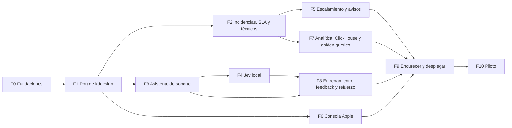

# Plan de trabajo — jsrbot (`jsr-vs7`)

jsrbot se construye **a partir de kddesign** (`../ddesign-k`, el asistente de ventas de Baruka en producción). Se
trae su código, que ya funciona y está probado, y se adapta a soporte técnico. Encima se construye lo que kddesign
no tiene:

- gestor de incidencias;
- personal técnico;
- escalamiento;
- Jev local;
- ClickHouse con golden queries;
- consola al estilo Apple.

Contexto: [`CONTEXT.md`](CONTEXT.md) · Reglas: [`AGENTS.md`](AGENTS.md) · Arquitectura:
[`ARQUITECTURA.md`](ARQUITECTURA.md) · Diseño: [`DISENO.md`](DISENO.md) · Skills: [`SKILLS.md`](SKILLS.md).

Estado: **F0 en curso** (05-10-2026). Las fases no llevan fechas: dependen del alcance que defina el cliente
(`CONTEXT.md` §7).

---

## 1. Fases

Tras F1 se trabaja en cuatro carriles en paralelo, uno por rol:

1. Backend: F2 y F5.
2. Agente: F3, F4 y F8.
3. Interfaz: F6.
4. Datos: F7.

| Fase | Objetivo | Dueño | Criterio de salida |
|---|---|---|---|
| **F0** | Fundaciones | Arquitecto | Documentos, skills del proyecto, decisiones y preguntas al cliente |
| **F1** | Port de kddesign | Backend + Agente | Lo de ventas fuera y todo en verde con nombres de jsrbot |
| **F2** | Incidencias, SLA y técnicos | Backend | Ciclo de vida, reloj de SLA y despachador probados |
| **F3** | Asistente de soporte | Agente | Regresión de soporte en verde; el asistente abre incidencias |
| **F4** | Jev local | Juez | Evaluación medida; en sombra en el agente |
| **F5** | Escalamiento y avisos | Backend | Vigía y reglas en sombra contra datos sintéticos |
| **F6** | Consola Apple | Diseño UI | Pantallas 02, 03, 06, 11 y 15 con estados reales y revisadas |
| **F7** | Analítica | Datos | ClickHouse alimentado; golden queries en verde; Indicadores y Reportes |
| **F8** | Entrenamiento, feedback, refuerzo | Agente + Diseño | Cola de revisión → reentrenar → comparar → publicar |
| **F9** | Endurecer y desplegar | Todos | Servidor, respaldos, carga, seguridad, `audit` |
| **F10** | Piloto | Todos | Dos semanas con usuarios reales y KPI medidos |

---

## 2. Fases en detalle

### F0 · Fundaciones

**Hecho (05-10-2026):**

- [x] Carpeta `jsr-vs7/` con `CONTEXT.md`, `AGENTS.md`, `SKILLS.md`, `PLAN_TRABAJO.md`, `ARQUITECTURA.md`,
  `DISENO.md` y `.better-web-ui.md`.
- [x] Las 33 skills de diseño de EDISYS copiadas a `.agents/skills/`, con `skills-lock.json`.
- [x] Copias de referencia de la arquitectura y del diseño WhatsApp de kddesign en `referencias/baruka/`.
- [x] Investigación de Jev local, clasificadores y ClickHouse (`docs/INVESTIGACION_JEV_LOCAL.md`).

**Pendiente:**

- [ ] Crear las skills del proyecto (`SKILLS.md` §2): `jsr-golden-query`, `jsr-entrenar`, `jsr-jev-local`,
  `jsr-regresion`, `jsr-sla`, `jsr-escalamiento`, `jsr-revisar-conversaciones`. `jsr-desplegar` se crea en F9.
- [ ] Registrar las decisiones (ADR) en `docs/decisiones/`:
  - 0001 Postgres en vez de SQLite.
  - 0002 ClickHouse solo para reportes, con outbox.
  - 0003 Jev local como combinación de modelos.
  - 0004 Qwik para la consola.
  - 0005 Eventos inmutables.
- [ ] Mandar al cliente las preguntas de `CONTEXT.md` §7. Sin respuesta, se sigue con supuestos marcados.
- [ ] Repositorio git propio y, si el usuario lo pide, su remoto.

### F1 · Port de kddesign

**Objetivo:** tener en `jsr-vs7` el esqueleto de kddesign funcionando, sin nada de ventas, con nombres de jsrbot y
con sus pruebas en verde. El mapa de cada archivo está en la §3.

1. **Copiar el código.** Se copia `ddesign-k` sin `.git`, `.env`, `agente/seed/pago.md`, volúmenes, `finetune/`
   ni imágenes de productos.
2. **Renombrar.** Contenedores `kddesign_*` → `jsrbot_*`, módulo Go `github.com/davrv93/ddesign-k/backend` →
   `jsrbot/backend`, red y volúmenes.
3. **Quitar lo de ventas** (§3, columna «No se lleva»): stock, pedidos, pagos, tallas, búsqueda por foto, Kommo,
   sucursales, temperatura de venta, cita para probarse.
4. **Cambiar SQLite por Postgres** en `internal/store`: las mismas interfaces y migraciones nuevas. Las pruebas
   del store corren contra un Postgres de prueba (contenedor efímero).
5. **Datos sintéticos de soporte** (`agente/data/`): sustituyen a los de ventas.
   - `intenciones_soporte.csv`: 13 intenciones × ≥ 30 frases, en tríos.
   - `categorias.csv`.
   - `prueba_soporte.csv`: reservado, no entra al entrenamiento.
   Los genera un modelo y los revisa una persona. Se marcan como sintéticos.
6. **Base de conocimiento de ejemplo:** 20 artículos de soporte genérico (Outlook, VPN, impresora, contraseña,
   wifi…). Marcados `SUPUESTO:` hasta tener los de la organización.
7. **Mantener:** el chat web con piel de WhatsApp, la cola de salida, la sesión de 6 h, la capa de juicio en
   sombra, `decisiones` y `pares_dpo` (que pasa a `pares_preferencia`).

**Salida:**

- `go test ./...` en verde.
- Build del agente con sus pruebas en verde y la exactitud del clasificador de soporte en el log, sobre el
  conjunto reservado.
- El chat web conversa con el asistente de soporte, aunque todavía no abra incidencias.

### F2 · Incidencias, SLA y personal técnico

- [ ] Esquema de Postgres de incidencias, eventos, categorías, técnicos, grupos, habilidades, turnos, ausencias,
  guardias, SLA, calendarios y feriados (`ARQUITECTURA.md` §8.1).
- [ ] Ciclo de vida (§3.1) con eventos inmutables. El estado actual es una proyección de los eventos.
- [ ] Matriz de prioridad configurable.
- [ ] **Reloj de SLA** en horario laboral, con feriados de Perú y pausas. Las pruebas cubren:
  - una incidencia creada un viernes a las 17:55;
  - un feriado en medio;
  - dos pausas;
  - P1 24×7.
- [ ] **Despachador** (§3.2) con pruebas de empate, técnico fuera de turno y grupo sin candidatos.
- [ ] API de la consola para incidencias, técnicos y configuración; roles (técnico, supervisor, gerencia,
  entrenador, administrador).
- [ ] `cmd/semilla`: 3 meses de incidencias sintéticas, con casos difíciles. Es la misma semilla de F7.

**Salida:** pruebas del reloj, del despachador y del ciclo de vida en verde; la semilla carga sin errores.

### F3 · Asistente de soporte

- [ ] Etapas de atención (`ARQUITECTURA.md` §2.1) en `etapas.py`, con su `prueba_etapas`.
- [ ] Ficha del caso y `memoria.siguiente()` por categoría (§2.2), con su `prueba_memoria`.
- [ ] RAG sobre artículos y soluciones de incidencias cerradas (`conocimiento.py`).
- [ ] Herramientas del agente:
  - crear incidencia, con propuesta de tipo, categoría, impacto, urgencia y resumen;
  - consultar el estado de las incidencias de la persona;
  - añadir un dato a una incidencia abierta.
- [ ] Flujos fijos para número, plazo, técnico, estado, confirmación de cierre y encuesta.
- [ ] Detección y ocultación de contraseñas y tokens.
- [ ] Respuesta estructurada (`responde`, `pasos`, `pregunta`) y respaldo por código sin LLM.
- [ ] **Regresión de soporte:**
  - 60 preguntas;
  - 30 conversaciones completas: falla resuelta con guía, falla que acaba en incidencia, consulta de estado, P1,
    persona que pide un técnico, contraseña pegada, cambio de tema;
  - entradas raras;
  - carga.

**Salida:** regresión 100 % en verde; p95 < 1 s sin LLM; el asistente abre incidencias en la base de F2.

### F4 · Jev local

- [ ] Contenedor `juez/` con `llama-server` y Qwen3-1.7B Q4_K_M. Modelo descargado con hash fijo; `json_schema`;
  caché del prefijo.
- [ ] `agente/app/juez.py`: la cascada de clasificación, con el mismo contrato que `jev.py` de kddesign, para
  poder cambiar uno por otro.
- [ ] `agente/app/verificar.py`:
  - mDeBERTa-xnli por frase (ONNX int8);
  - LettuceDetect-es para tramos;
  - reranker para «¿contestó?».
- [ ] **Conjunto dorado**, etiquetado por dos personas con el acuerdo medido:
  - 300 turnos de clasificación;
  - 200 pares respuesta-fuente con las frases marcadas.
- [ ] `evaluar_juez.py`: macro-F1, ECE, curva de la cascada, recall de alucinaciones y AUROC, p50 y p95. Si queda
  saldo, acuerdo con Jev de pago.
- [ ] Encendido en `sombra` dentro del agente: registra sus veredictos sin actuar.
- [ ] Si Qwen3-1.7B no cabe en la latencia, medir granite-4.0-1b y Qwen3-0.6B. Si el NLI no alcanza el recall,
  añadir LettuceDetect como filtro obligatorio.

**Salida:**

- Recall de alucinaciones ≥ 0,9 con precisión ≥ 0,7 en el conjunto dorado.
- Cascada con macro-F1 ≥ al de e5 solo en los casos dudosos.
- p95 del juez < 2 s en el servidor de referencia.
- Las tres cifras quedan en `docs/` antes de pasar a `activo`.

### F5 · Escalamiento y avisos

- [ ] Reglas de escalamiento como datos versionados, con modo `sombra` o `activo` (§3.3).
- [ ] Vigía de SLA cada minuto, idempotente: un aviso se manda una sola vez aunque el vigía se reinicie.
- [ ] Avisos al usuario y al técnico por WhatsApp y por correo, con plantillas configurables. **Nunca a números
  reales en pruebas.**
- [ ] Página pública de estado de la incidencia, con enlace firmado y caducidad.
- [ ] Reproducción histórica: correr las reglas sobre la semilla y listar qué habrían hecho.

**Salida:** las pruebas de cada disparador en verde; la reproducción sobre la semilla coincide con lo esperado.

### F6 · Consola al estilo Apple

Avanza en paralelo con F2 a F5, sobre la API conforme exista.

- [ ] `web/src/tokens.css` desde `.better-web-ui.md`, en claro y oscuro.
- [ ] Componentes base (`DISENO.md` §3), con la skill `extract`.
- [ ] Pantallas por orden de valor:
  1. 02 Bandeja;
  2. 03 Detalle;
  3. 06 y 07 Equipo;
  4. 15 Ajustes (SLA, calendario, categorías, matriz);
  5. 11 y 12 Asistente (comportamiento, conocimiento);
  6. 04 Incidencias;
  7. 05 Conversaciones;
  8. 08 Escalamiento;
  9. 16 Estado público;
  10. 01 Login.
- [ ] Chat web de prueba adaptado (`DISENO.md` §2.17).
- [ ] Antes de cerrar cada pantalla, las skills `distill`, `hierarchy`, `a11y`, `adapt` y `polish`, en claro y
  oscuro y a 393 px, 1280 px y 1600 px.

**Salida:** cada pantalla con sus estados de carga, vacío y error, probada con la semilla (datos feos incluidos).

### F7 · Analítica: ClickHouse y golden queries

- [ ] Contenedor ClickHouse con el perfil de poca memoria (`ARQUITECTURA.md` §9) y un usuario de solo lectura para
  el analista.
- [ ] `outbox_analitica` en Postgres y un trabajador por lotes con idempotencia.
- [ ] Esquema y vistas (§8.2). `incidencias_tiempos` la calcula el backend.
- [ ] Las 12 golden queries iniciales (§8.3), cada una con `meta.yaml`, SQL y `esperado.csv` sobre la semilla.
  Se crean con la skill `jsr-golden-query`.
- [ ] `probar_golden.sh` en verde.
- [ ] Pantalla 09 Indicadores, que solo lee golden queries.
- [ ] Pantalla 10 Reportes: explorador, exportación CSV/XLSX, reportes programados por correo.
- [ ] Analista en lenguaje natural:
  - primero el catálogo de golden queries;
  - si no hay, SQL «sin verificar» con límites;
  - evaluado por resultado sobre 50 preguntas.
- [ ] Prueba de reconstrucción: borrar ClickHouse y reconstruirlo desde Postgres da las mismas cifras.

**Salida:** golden queries en verde; reconstrucción idéntica; el analista acierta ≥ 90 % de las preguntas que
tienen golden query.

### F8 · Entrenamiento, feedback y refuerzo

- [ ] Señales de feedback (`ARQUITECTURA.md` §7.2) guardadas como eventos: 👍/👎, «se resolvió» / «sigue igual»,
  encuesta, edición del técnico, corrección de intención o categoría, reapertura.
- [ ] Pantalla 13 Entrenamiento: cola de revisión, etiquetado, reentrenar, comparar y publicar. Los modelos se
  versionan en `modelos`.
- [ ] Pantalla 14 Calidad: exactitud por versión, % de frases quitadas por el verificador, contención, CSAT del
  asistente.
- [ ] Bandido de artículos en sombra (§7.3). Se compara su orden con el del RAG puro contra la tasa de «se
  resolvió».
- [ ] Pares de preferencia desde las ediciones de los técnicos.
- [ ] Auditoría nocturna con Selene-1-Mini (opcional, si sobra RAM de noche).
- [ ] Calibración mensual de umbrales con la skill `jsr-jev-local`.

**Salida:** un ciclo completo (revisar, reentrenar, comparar, publicar) hecho de punta a punta sobre datos de F3.

### F9 · Endurecer y desplegar

- [ ] Servidor según la respuesta del cliente; presupuesto de RAM medido (`ARQUITECTURA.md` §9).
- [ ] `DEPLOY.md` y skill `jsr-desplegar`. Imágenes construidas fuera del servidor o de una en una.
- [ ] Respaldo diario de Postgres (con la sesión de WhatsApp) hacia almacenamiento externo, y prueba de
  restauración. ClickHouse no se respalda: se reconstruye.
- [ ] Carga: 50 conversaciones en paralelo y vigía con 5000 incidencias abiertas.
- [ ] Revisión de seguridad: roles, enlaces públicos firmados, enmascarado antes del LLM externo, secretos, límites
  del analista.
- [ ] Skill `audit` sobre la consola, sin hallazgos P0 ni P1.

**Salida:** desplegado con respaldo probado y sin hallazgos P0 ni P1.

### F10 · Piloto

- [ ] Dos semanas con un grupo real, con el juez y las reglas nuevas en `sombra` la primera semana.
- [ ] Línea base de los KPI (golden queries) al inicio y al final.
- [ ] Revisión semanal de conversaciones (`jsr-revisar-conversaciones`).
- [ ] Decisión de pasar de `sombra` a `activo` cada pieza, con su cifra.

---

## 3. Mapa del port: de `ddesign-k` a `jsr-vs7`

Acciones:

- **Copiar:** se trae tal cual, cambiando solo los nombres.
- **Adaptar:** se trae y se reescribe la lógica de dominio.
- **No se lleva:** es solo de ventas.

### 3.1 Agente (`agente/app/`)

| kddesign | Acción | jsrbot |
|---|---|---|
| `modelo.py`, `entrenar.py`, `datos.py` | Copiar | Igual: clasificador e5 + regresión logística, con datos de soporte |
| `setfit.py` | Copiar (apagado) | Se vuelve a medir en F3 |
| `memoria.py` | Adaptar | Ficha del caso: pendiente, extracción, `siguiente()` y `quitar_repetidas` se conservan. Cambian los datos (equipo, sede, desde, error, impacto, urgencia, pasos probados). Fuera la temperatura y la cita |
| `etapas.py` | Adaptar | Etapas de atención en vez de comerciales; mismo patrón de umbrales y bitácora |
| `estructurado.py` | Adaptar | `responde`, `pasos` (numerados, solo del artículo) y `pregunta` |
| `jev.py` | Adaptar | `juez.py` con el mismo contrato, contra `llama-server` local; la verificación pasa a `verificar.py` |
| `animo.py` | Copiar | Ánimo y urgencia; alimenta el escalamiento por queja |
| `regresion.py`, `conversaciones.py`, `evaluar.py`, `evaluar_jev.py` | Adaptar | Casos de soporte; `evaluar_jev.py` pasa a `evaluar_juez.py` |
| `gasto.py` | Copiar | Costo del LLM por caso (es un KPI) |
| `crm.py` | Adaptar | Aviso al backend al final de cada turno web (sin Kommo) |
| `main.py` | Adaptar | Mismo orden del turno; el RAG lee artículos; las herramientas son de incidencias en vez de stock |
| `ui.html` | Adaptar | Chat web de prueba (`DISENO.md` §2.17) |
| `prueba_*.py` | Adaptar | Mismos nombres, casos de soporte; siguen corriendo en el build |
| `venta.py`, `stock.py`, `imagen.py`, `sucursales.py`, `rerank.py` | No se lleva | El reranker vuelve como «¿contestó?» en `verificar.py` |
| `data/*.csv` y `regresion_*` | No se lleva | Se reemplazan por los conjuntos de soporte de F1 |
| `seed/` (tienda, venta, pago, producto demo) | No se lleva | `seed/organizacion.md` y artículos de ejemplo |
| `finetune/` | No se lleva | Conclusión heredada: el ajuste local de un LLM no es viable en CPU |
| `Dockerfile` | Adaptar | Mismo esquema (entrenar y probar en el build) más los modelos ONNX del verificador |

### 3.2 Backend (`backend/`)

| kddesign | Acción | jsrbot |
|---|---|---|
| `internal/evolution` | Copiar | Canal WhatsApp |
| `internal/agente` | Copiar | Cliente del agente, con campos nuevos (incidencias abiertas, perfil) |
| `internal/bot/bot.go`, `incoming.go` | Adaptar | `internal/caso`: webhook, sesión de 6 h, pausa por técnico, `sendAgentText`, flujos fijos de incidencia en vez de pedido |
| `internal/bot/outbox.go` | Copiar | Cola de salida por chat |
| `internal/bot/memoria.go` | Adaptar | Persistencia de la ficha del caso y perfil de la persona |
| `internal/bot/juicio.go`, `internal/juicio` | Copiar | Capa de juicio en sombra |
| `internal/bot/dpo.go` | Adaptar | `pares_preferencia` desde las ediciones de los técnicos |
| `internal/bot/followup.go` | Adaptar | Recordatorio de confirmación de cierre y de la encuesta |
| `internal/bot/crm.go` | Adaptar | El «turno» con hitos pasa a eventos de incidencia y outbox de analítica |
| `internal/store` | Adaptar | Postgres; fuera `orders`, `products`, `stock`, `kommo`; dentro incidencias, técnicos, SLA, conocimiento |
| `internal/api` | Adaptar | API de la consola y del estado público; `hub.go` (eventos en vivo al panel) se conserva |
| `internal/auth`, `internal/config` | Copiar | Con roles nuevos |
| `internal/ai` (Gemini) | Copiar | Respaldo si el agente no responde |
| `internal/kommo`, `cmd/kommo-seed`, `internal/seed` | No se lleva | El gestor de incidencias es propio; la semilla nueva es `cmd/semilla` |
| `*_test.go` | Adaptar | Mismos patrones (agente y Evolution simulados); casos de soporte |

### 3.3 Frontend, despliegue y documentos

| kddesign | Acción | jsrbot |
|---|---|---|
| `frontend/` (Qwik: `lib/api.ts`, `base.ts`, `format.ts`, rutas del panel) | Adaptar | `web/`: se conservan el arranque Qwik, `base.ts` (ruta base) y `api.ts`. Las pantallas se rehacen al estilo Apple (F6) |
| `docker-compose.yml` | Adaptar | Servicios de `ARQUITECTURA.md` §1 con límites de memoria |
| `DEPLOY.md` (§1 regresión, §3.1 qué mirar en el build, §7 respaldo) | Adaptar | `DEPLOY.md` de jsrbot en F9 |
| `CLAUDE.md`, `AGENTS.md` | Adaptar | Ya en `CONTEXT.md` y `AGENTS.md` |
| `ARQUITECTURA.md`, `DISENO_WHATSAPP.md` | Referencia | En `referencias/baruka/` |
| `landing-baruka/`, `demo-hub/` | No se lleva | — |

**Lecciones de kddesign que se conservan como reglas:**

- No imprimir secretos.
- No mandar WhatsApp de prueba a números reales.
- No borrar pruebas.
- Medir antes de afirmar.
- Construir de una imagen a la vez.
- Respaldar antes de desplegar.

---

## 4. Riesgos

| Riesgo | Efecto | Mitigación |
|---|---|---|
| El cliente no define el alcance, el SLA ni el volumen | Se construye sobre supuestos | Supuestos marcados con `SUPUESTO:`, todo configurable; preguntas en F0 |
| El juez en CPU no cabe en la latencia | Respuestas lentas | Cascada poco frecuente; modelos de 0,6–1B; caché del prefijo; servidor de 4 vCPU |
| ClickHouse y el juez no caben con 8 GB | Caídas por memoria | Topes por contenedor; perfil de poca RAM; juez de auditoría solo de noche; servidor de 16 GB |
| Sin conversaciones reales para entrenar | Exactitud baja al inicio | Datos sintéticos revisados; aprendizaje activo desde el piloto |
| El saldo del LLM de redacción se agota | Respuestas menos naturales | Respaldo por código (herencia de kddesign); aviso de saldo en la consola |
| Datos personales en el LLM externo | Riesgo legal | Enmascarado obligatorio y probado (F3, F9) |
| Dos agentes editan lo mismo | Trabajo pisado | Un dueño por archivo (`AGENTS.md` §2); `git status` antes de cada commit |

---

## 5. Decisiones pendientes del usuario

1. Organización, alcance y significado de «vs7» (`CONTEXT.md` §7.1).
2. Servidor y dominio.
3. Número de WhatsApp para jsrbot.
4. Si `jsr-vs7` lleva repositorio remoto propio, y si es público o privado. Es privado por defecto, porque tendrá
   datos de una organización.
